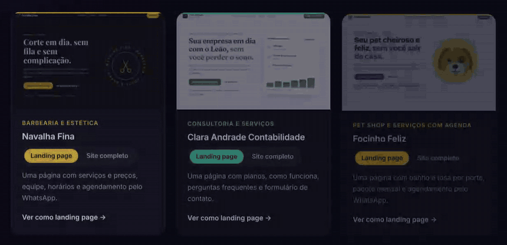

# Landing pages for small local businesses

[](https://github.com/Arthur-DBorghi/LandingPage/actions/workflows/qualidade.yml)

**Live:** https://arthurdefendiborghi.arthur-defborghi.workers.dev · [Versão em português](README.pt-BR.md)

A side business I run alongside a full-time developer job: ready-made landing pages and 5-page websites for barbershops, pet shops, accountants and other local businesses in Brazil. This repository is the sales site plus three demo businesses (all fictional), each available as a one-page landing page and as a full 5-page site, so a prospect can compare both versions of the same business.



## The problem

Most small businesses in my area live on Instagram and WhatsApp. They want a page that shows up on Google and sends customers straight to a WhatsApp chat, but agency prices are out of reach, and site builders still leave them doing the work.

My constraints shaped every decision:

- **Time:** about 4 hours a week to build, more only when there is a paying client.
- **Support:** each client must cost almost nothing to keep online, or the monthly maintenance plan stops making sense.
- **Price:** R$ 500 for a landing page, R$ 850 for a 5-page site. That only works if a new client starts from a finished, tested template.

## Key decisions

**1. Plain HTML, CSS and JavaScript, no framework and no build step.**
These pages are mostly content with a few interactions (a mobile drawer, a price selector, forms that compose a WhatsApp message). A framework would add a build, dependency updates and page weight, and buy nothing a visitor would notice. Every page here weighs between 81 and 327 KB. The trade-off is repetition: the header, drawer and footer of the 5-page sites were generated once and are now plain HTML edited by hand. For a handful of pages per client, that is cheaper than maintaining a component system.

**2. Cloudflare instead of Netlify, Vercel or GitHub Pages.**
The site started on Netlify, whose free plan moved to monthly credits (15 per deploy, roughly 20 deploys a month) and pauses sites when they run out. Vercel's free tier and GitHub Pages both restrict commercial use. Cloudflare Workers static assets serve static files at no cost, allow commercial use and give every Git branch its own preview URL, which became the review workflow: every change ships to a branch, gets checked on the preview, and only then merges to `main`.

**3. One stylesheet per business, two products on top of it.**
The 5-page sites load the landing page's own stylesheet and add one shared file (`modelos/comum/site.css`) for menus, page headers, the drawer and the footer. That shared file reads colors through CSS custom properties, so the barbershop's dark gold theme came from overriding 11 variables, not from writing a second set of components.

**4. The demo layer is removable by design.**
Every WhatsApp button in the demos carries a `data-whats` attribute. On the demos, `demo.js` adds the "this is a fictional business" banner and shows the message that would be sent. To turn a demo into a client site, you delete that script and swap the attributes for real `wa.me` links. Nothing else in the code knows the demo exists.

**5. Animations that cannot hide content.**
Scroll animations only switch on once JavaScript runs (a class on `<html>`), so with JavaScript off nothing is left invisible. They respect the system's reduced-motion setting, and they use the individual `translate`/`scale` properties so they never fight with hover effects that use `transform`.

**6. No JSON template engine.**
I considered a JSON-driven editor that would generate each client's page. I dropped it: every client wants something slightly different, and editing HTML directly is faster than growing a schema to cover every case. Instead, each client starts from a copy of a demo.

## Quality

Every push and pull request runs two jobs in GitHub Actions ([`qualidade.yml`](.github/workflows/qualidade.yml)), both in [`testes/`](testes/README.md). That folder has its own `package.json` and is excluded from deployment, so the site itself stays dependency-free.

- **Playwright (TypeScript):** all 22 pages at desktop, tablet and phone sizes. The checks:
  - no console errors, missing files or horizontal scroll, and every animated element ends up visible;
  - every internal link and `#anchor` resolves, and the `_redirects` rules and the 404 page work;
  - the drawer, forms, price selector and portfolio toggle behave as expected;
  - the quote form builds the right WhatsApp message;
  - basic SEO: language, title, description length, a single `h1`, and `noindex` only on the demos.
- **axe-core:** WCAG 2.1 A and AA rules on every page, on desktop and phone.
- **Lighthouse CI:** 8 pages, 3 runs each, with minimum scores and a layout-shift budget (CLS ≤ 0.1).

A zero-dependency Node server (`testes/servidor.mjs`) mimics Cloudflare's behavior for the tests: directory indexes, the 404 page and the `_redirects` file.

**What the tests caught on their first run:**
- **Color contrast below 4.5:1** in three places: green labels on a tinted background, yellow text on blue and a muted price suffix.
- **Heading order:** two pages jumped from `h1` to `h3`.
- **An unnamed link:** on phones the logo link in the header had no accessible name.
- **A layout shift of 0.10 that only showed up sometimes.** Tracing the shift entries showed the whole `<main>` moving down about 90 px: the demo banner was inserted by a deferred script after the first paint. Loading that small demo-only script at the top of `<body>` and preloading the body font brought CLS to 0, and the CLS budget now keeps it there.


## A new client in one command

Turning a demo into a client's site used to be a six-step manual checklist, and forgetting one step is expensive: leave the `noindex` tag and the client never shows up on Google. [`ferramentas/novo-cliente`](ferramentas/README.md) is a small Node.js CLI that does the mechanical part in seconds:

- **Copies only what the pages use** into a clean `assets/` structure, rewriting paths in both the HTML and the CSS.
- **Strips the demo layer** and wires every button and form to the client's real WhatsApp number.
- **Swaps the fictional business for the client's.** Portuguese articles change with the new name's gender ("da Navalha Fina" → "do Studio Corte"), so the copy still reads naturally.
- **Lists everything still fictional,** with file and line, in the new site's to-do file.

The same core runs in two places. A private web panel on the site has a form, a live preview at phone and desktop sizes and a .zip download, so creating a client site needs no terminal. The CLI is still there for scripting. The core never touches Node APIs: each entry point hands it a file reader (`fetch` in the browser, `fs` in Node), and both produce byte-identical sites. The panel's .zip writer is about 100 lines of dependency-free JavaScript.

HTML edits are surgical: parse5 reports the exact position of every tag and attribute, and changes are applied at those offsets, so the client gets the same hand-formatted HTML instead of serializer output. Types are checked with JSDoc and `tsc`, still without a build step. On every push, CI converts all six demos and checks that no demo leftovers remain, every referenced file exists and every button opens the right WhatsApp chat with the same message.

## Results

| | |
|---|---|
| Lighthouse (mobile, simulated throttling) | Performance 97–100 · Accessibility 100 · Best Practices 100 · SEO 100 |
| Cumulative Layout Shift | 0 on all audited pages |
| Largest Contentful Paint (simulated mobile) | 0.9–1.7 s |
| Page weight | 81–327 KB (the largest is the home page, with the phone mockups) |
| Automated checks | 159 browser checks per push (about 3 minutes in CI), 24 Lighthouse runs and 34 tests for the client tool and panel |
| Hosting cost | Zero |

As of November 2026 the business has no paying clients yet. This site and its demos are the first thing a prospect sees.

## What's next

- **Version 2 of the client tool:** generate `sitemap.xml`, `robots.txt`, canonical URLs and LocalBusiness structured data, and run the Playwright and axe suites against each generated site.
- **A small backend on Cloudflare:** store quote requests in D1, block spam with Turnstile and add a private dashboard behind Cloudflare Access. This goes on my own site only, so client sites keep zero moving parts.
- **A custom domain** and SEO for the sales site itself.

## How it's built

I work with Claude (Anthropic's AI assistant) as a pair programmer. I set the direction, review every change on a preview branch and decide what ships. That's why some commits list it as co-author.

## Run it locally

The site needs no build: open it with any static server (for example VS Code's Live Server). To run the tests:

```bash
cd testes
npm install
npx playwright install chromium
npm test             # Playwright + axe
npm run lighthouse   # Lighthouse CI (needs Chrome)
```

## Project structure

```
index.html, orcamento.html, politicas.html, 404.html   sales site (Portuguese)
assets/                                                CSS, JS, self-hosted fonts, images
modelos/<business>/                                    demo as a landing page
modelos/<business>-completo/                           demo as a 5-page site
modelos/comum/                                         shared demo, animation and multi-page pieces
testes/                                                automated tests (not deployed)
ferramentas/                                           the "new client" tool: shared core is deployed for the panel, CLI and tests are not
painel/                                                private panel for creating client sites
docs/img/                                              images for this README (not deployed)
```
