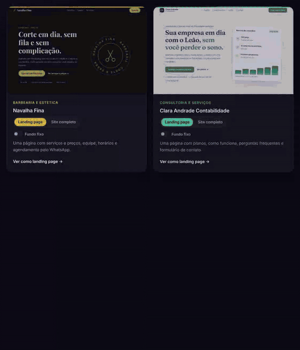
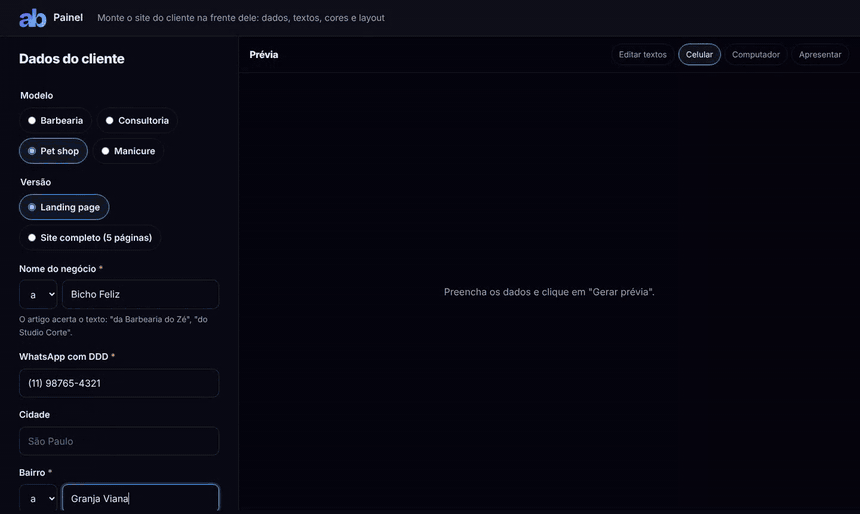

# Landing pages para pequenos negócios locais

[](https://github.com/Arthur-DBorghi/LandingPage/actions/workflows/qualidade.yml)

**No ar:** https://arthurborghi.com.br · [English version](README.md)

Um negócio paralelo que eu toco junto com meu trabalho de TI: landing pages e sites de 5 páginas prontos para barbearias, esmalterias, pet shops, contadores e outros negócios locais de Cotia, Barueri e região. Este repositório tem o site de vendas, quatro vitrines de negócios fictícios e um painel de vendas privado. Cada vitrine existe como landing page de uma página e como site completo de 5 páginas, com fundo fixo opcional, para o cliente comparar as versões do mesmo negócio.



## O problema

A maioria dos pequenos negócios da minha região vive no Instagram e no WhatsApp. Eles querem uma página que apareça no Google e leve o cliente direto para uma conversa no WhatsApp, mas preço de agência não cabe no bolso, e nos construtores de site o trabalho continua sendo deles.

As minhas restrições guiaram cada decisão:

- **Tempo:** umas 4 horas por semana para construir, mais só quando há cliente pagando.
- **Suporte:** cada cliente precisa custar quase nada para ficar no ar, senão o plano de manutenção mensal deixa de fazer sentido.
- **Preço:** R$ 500 a landing page e R$ 850 o site de 5 páginas. Isso só fecha se cada cliente novo partir de um modelo pronto e testado.

## Decisões principais

**1. HTML, CSS e JavaScript puro, sem framework e sem etapa de build.**
As páginas são quase só conteúdo, com poucas interações (gaveta no celular, seletor de preço, formulários que montam a mensagem do WhatsApp). Um framework traria build, atualização de dependências e peso, sem nada que o visitante perceba. As páginas auditadas pesam entre 84 e 356 KB. O custo é a repetição: o topo, a gaveta e o rodapé dos sites de 5 páginas foram gerados uma vez e hoje são HTML editado à mão. Para poucas páginas por cliente, isso sai mais barato que manter um sistema de componentes.

**2. Cloudflare em vez de Netlify, Vercel ou GitHub Pages.**
O site começou na Netlify, cujo plano grátis passou a funcionar com créditos mensais (15 por deploy, uns 20 deploys por mês) e pausa o site quando eles acabam. O plano grátis da Vercel e o GitHub Pages restringem uso comercial. Os static assets do Cloudflare Workers servem arquivos estáticos sem custo, permitem uso comercial e dão um endereço de prévia para cada branch do Git. Isso virou o fluxo de revisão: toda mudança vai para um branch, é conferida na prévia e só então entra no `main`. As prévias dos branches e o painel de vendas ficam atrás do Cloudflare Access.

**3. Um CSS por negócio, dois produtos em cima dele.**
Os sites de 5 páginas carregam o próprio CSS da landing page e somam um arquivo comum (`modelos/comum/site.css`) com menu, cabeçalhos de página, gaveta e rodapé. Esse arquivo lê as cores por variáveis de CSS. Por isso o tema escuro e dourado da barbearia saiu de 11 variáveis redefinidas, e não de um segundo conjunto de componentes.

**4. A camada de demonstração sai inteira.**
Todo botão de WhatsApp das vitrines tem um atributo `data-whats`. Nas vitrines, o `demo.js` coloca a faixa "negócio fictício" e mostra a mensagem que seria enviada. Para virar site de cliente, basta apagar esse script e trocar os atributos por links `wa.me` de verdade. Nenhuma outra parte do código sabe que a demonstração existe.

**5. Animações que não escondem conteúdo.**
As animações de rolagem só ligam quando o JavaScript roda (uma classe no `<html>`); sem JavaScript, nada fica invisível. Elas respeitam o "reduzir movimento" do sistema e usam as propriedades `translate`/`scale` separadas, para não brigar com efeitos de hover que usam `transform`.

**6. Sem motor de templates por JSON, mas com variações de layout.**
Cheguei a considerar um editor que geraria a página de cada cliente a partir de um JSON e desisti: cada cliente quer algo um pouco diferente, e editar o HTML direto é mais rápido que ampliar um esquema para cobrir todos os casos. Cada cliente parte de uma cópia de uma vitrine. Para os sites não ficarem parecidos, um único CSS (`modelos/comum/variacoes.css`) traz variações que funcionam em todas as vitrines: quatro estilos de topo, um fundo fixo com a página rolando por cima, e seções que mudam de ordem ou ficam escondidas. Ele só usa classes e variáveis que as quatro vitrines têm em comum.

## Qualidade

Cada push e cada pull request rodam três jobs no GitHub Actions ([`qualidade.yml`](.github/workflows/qualidade.yml)). Os testes no navegador ficam em [`testes/`](testes/README.md), pasta com `package.json` próprio e fora da publicação, então o site continua sem dependências.

- **Playwright (TypeScript):** as 34 páginas em computador, tablet e celular. O que confere:
  - nenhum erro no console, arquivo faltando ou rolagem lateral, e todo elemento animado termina visível;
  - todo link interno e toda `#âncora` funcionam, assim como as regras do `_redirects` e a página 404;
  - a gaveta, os formulários, o seletor de preço, as opções do portfólio e o fundo fixo funcionam;
  - troca de página nos sites de 5 páginas: regras de transição carregadas, próxima página preparada ao passar o mouse, sem animação de entrada quando se chega do próprio site;
  - o formulário de orçamento monta a mensagem certa para o WhatsApp;
  - SEO: idioma, título, tamanho da descrição, um único `h1`, `noindex` só nas vitrines, endereço oficial (canonical), `robots.txt` e `sitemap.xml`;
  - o painel de vendas, do começo ao fim (ver abaixo).
- **axe-core:** regras WCAG 2.1 níveis A e AA em todas as páginas, no computador e no celular, além da ordem dos títulos.
- **Lighthouse CI:** 10 páginas, 3 execuções cada, com notas mínimas e limite de deslocamento de layout (CLS ≤ 0,1).
- **Ferramenta de clientes:** converte as oito vitrines a cada push (ver abaixo).

Um servidor Node sem dependências (`testes/servidor.mjs`) imita a Cloudflare nos testes: índice de pastas, página 404 e o arquivo `_redirects`.

**O que os testes pegaram:**
- **Contraste abaixo de 4,5:1** em três lugares: sobretítulos verdes sobre fundo esverdeado, amarelo sobre azul e um "/mês" claro demais.
- **Ordem dos títulos:** páginas que pulavam do `h1` para o `h3`. O Lighthouse apontou uma; uma verificação nova do axe achou oito nas vitrines. Cada uma ganhou um `h2` só para leitores de tela, e a verificação agora roda em todas as páginas.
- **Um link sem nome:** no celular, o link do logo no topo não tinha nome acessível.
- **Um deslocamento de layout de 0,10 que aparecia só às vezes.** Rastreando os eventos de deslocamento, vi o `<main>` inteiro descer uns 90 px: a faixa de demonstração entrava por um script com `defer` depois da primeira pintura. Carregar esse script pequeno, que só existe nas vitrines, no início do `<body>` e pré-carregar a fonte do texto levou o CLS a 0, e o limite de CLS agora garante que ele fique lá.
- **Um LCP da página inicial que pulava entre 0,9 e 2,6 s de uma medição para outra.** O maior elemento era o título do topo, que era animado. Tirar o título da animação de entrada deixou o LCP estável em 0,9 s.


## Troca de página rápida

Nos sites de 5 páginas, o primeiro acesso e cada troca de página foram ajustados só com recursos da própria web, sem framework:

- **Speculation Rules:** no Chrome e no Edge, parar o mouse num link do menu já deixa a próxima página pronta (prerender), e o clique abre na hora. Os outros navegadores recebem um `<link rel="prefetch">` ao passar o mouse, tocar ou focar. Só valem páginas do próprio site; botões de WhatsApp, nunca.
- **View Transitions entre páginas:** `@view-transition { navigation: auto; }` troca o piscar em branco por um fade curto. Topo, faixa de demonstração e botão do WhatsApp ficam no lugar (`view-transition-name`); só o conteúdo muda. Quem pediu "reduzir movimento" não vê animação.
- **Sem esperar animação:** quem chega de outra página do mesmo site vê na hora o que já está na tela. A animação de entrada fica para a primeira visita e para o que aparece ao rolar.
- **Cache:** por padrão, todo arquivo é conferido de novo a cada página. Um arquivo `_headers` guarda CSS e JS por 10 minutos, imagens por um dia e fontes por um ano, e a ferramenta de clientes grava o mesmo arquivo em cada site de cliente.

Num celular simulado com 4G lento e processador 4 vezes mais lento, uma vitrine de 5 páginas mostra o conteúdo em cerca de 0,95 s e fica pronta perto de 1 s (antes de encurtar a animação, eram 1,4 s).

## Painel de vendas e um cliente novo com um comando

Transformar uma vitrine em site de cliente era um passo a passo manual de seis etapas, e esquecer uma custa caro: se o `noindex` fica, o cliente nunca aparece no Google. A [`ferramentas/novo-cliente`](ferramentas/README.md) faz a parte mecânica em segundos:

- **Copia só o que as páginas usam** para uma estrutura `assets/` limpa, reescrevendo os caminhos no HTML e no CSS.
- **Tira a camada de demonstração** e liga todos os botões e formulários ao WhatsApp de verdade do cliente.
- **Troca o negócio fictício pelo do cliente.** Os artigos mudam conforme o gênero do nome novo ("da Navalha Fina" → "do Studio Corte"), então o texto continua natural.
- **Lista tudo o que ainda é fictício,** com arquivo e linha, no roteiro do site novo, e grava a configuração da Cloudflare e o cache.

O mesmo núcleo roda em dois lugares. A linha de comando serve para automatizar. O **painel de vendas** privado (`/painel`) é o que eu uso na frente do cliente:

- preencho o nome do negócio e o WhatsApp e vejo a prévia em tamanho de celular e de computador;
- **clico em qualquer texto para editar** no lugar (Enter salva, Esc desfaz);
- **troco as cores da marca**, com aviso quando o contraste do texto fica abaixo de 4,5:1;
- **mudo o layout:** estilo do topo, fundo fixo, ordem das seções, seções escondidas;
- apresento em tela cheia e baixo o site do cliente num .zip igual à prévia.



O núcleo não usa nenhuma API do Node: cada porta de entrada entrega a ele uma função que lê arquivos (`fetch` no navegador, `fs` no Node), e as duas geram sites idênticos byte a byte. O gerador de .zip do painel tem umas 100 linhas de JavaScript, sem dependências. As edições no HTML são cirúrgicas, na ferramenta e no painel: o parse5 informa a posição exata de cada tag e atributo, e as mudanças entram nessas posições. Assim o cliente recebe o mesmo HTML formatado à mão, e não a saída de um serializador. O texto digitado no painel é limpo até sobrar só texto e as tags de destaque que a vitrine já usa. Os tipos são conferidos com JSDoc e `tsc`, ainda sem etapa de build. A cada push, o CI converte as oito vitrines e confere três coisas: nenhum resto de demonstração ficou para trás, todo arquivo citado existe e todo botão abre a conversa certa no WhatsApp, com a mesma mensagem.

## Resultados

| | |
|---|---|
| Lighthouse (celular, limitação simulada) | Desempenho 99–100 · Acessibilidade 100 · Boas práticas 100 · SEO 100 no site de vendas (as vitrines têm `noindex` de propósito) |
| Deslocamento de layout (CLS) | 0 em todas as páginas auditadas |
| Maior elemento visível (LCP, celular simulado) | 0,9–1,5 s |
| Peso das páginas | 84–356 KB (a maior é a inicial, com as telas de celular) |
| Verificações automáticas | 209 verificações no navegador a cada push, 30 execuções do Lighthouse e 47 testes da ferramenta de clientes e do painel |
| Custo de hospedagem | Zero (mais R$ 40 por ano do domínio) |

Em novembro de 2026 o negócio ainda não tem clientes pagantes. Este site e as vitrines são a primeira coisa que um possível cliente vê.

## Próximos passos

- **Versão 2 da ferramenta de clientes:** gerar `sitemap.xml`, `robots.txt`, endereço oficial (canonical) e dados estruturados de negócio local, e rodar os testes do Playwright e do axe em cada site gerado.
- **Um backend pequeno na Cloudflare:** pedidos de orçamento guardados no D1, bloqueio de spam com o Turnstile e um painel privado atrás do Cloudflare Access. Só no meu site, para os sites de clientes continuarem sem peças móveis.
- **Uma página por nicho** para a busca local ("site para pet shop em Cotia").

## Como é feito

Trabalho com o Claude (assistente de IA da Anthropic) como par de programação. Eu defino a direção, reviso cada mudança num branch de prévia e decido o que vai para o ar. Por isso alguns commits o listam como coautor.

## Rodar no computador

O site não precisa de build: abra com qualquer servidor estático (por exemplo, o Live Server do VS Code). Para rodar os testes:

```bash
cd testes
npm install
npx playwright install chromium
npm test             # Playwright + axe
npm run lighthouse   # Lighthouse CI (precisa do Chrome)
npm run imagens      # grava de novo os GIFs deste README (precisa do ffmpeg)

cd ../ferramentas
npm install
npm test             # ferramenta de clientes e painel (node:test)
npm run tipos        # conferência de tipos (tsc sobre JSDoc)
```

## Estrutura

```
index.html, orcamento.html, politicas.html, 404.html   site de vendas
robots.txt, sitemap.xml, _headers, _redirects          buscadores, cache e endereços antigos
assets/                                                CSS, JS, fontes próprias, imagens
modelos/<negócio>/                                     vitrine em landing page
modelos/<negócio>-completo/                            vitrine em site de 5 páginas
modelos/comum/                                         peças comuns: demonstração, animações, várias páginas, variações de layout
painel/                                                painel de vendas privado (atrás do Cloudflare Access)
ferramentas/                                           ferramenta "novo cliente": o núcleo é publicado para o painel; terminal e testes não
testes/                                                testes automáticos (não são publicados)
docs/img/                                              imagens deste README (não são publicadas)
```
